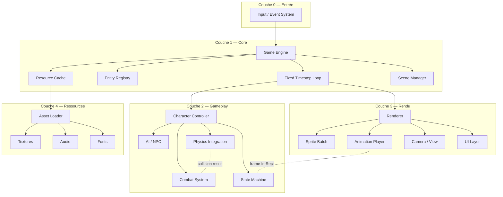
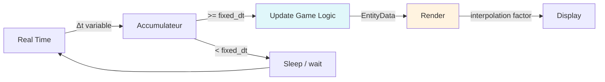

# Architecture — Naruto Pixel Burst

## 1. Technologie

| Aspect | Choix | Justification |
|--------|-------|---------------|
| **Langage** | C++20 | `std::span`, `std::string_view`, `#include <concepts>`, `co_await` — typage fort sans surcharge, zero-cost abstractions |
| **Graphiques / Audio** | SFML 2.6 | API haut niveau (Sprite, Texture, Music, Event) ; écosystème mature ; bindings simples |
| **Build** | Meson + Ninja | Configuration déclarative, multi-plateforme, découverte automatique des dépendances via `pkg-config`, compilation incrémentale ultra-rapide |
| **Physique** | Custom (OBB + pixel-perfect) | Le moteur existant (`Collision.h`, `Little_Physics_Engine.h`) est léger et adapté aux sprites 2D ; conservé dans `core/physics/` |

## 2. Architecture en couches



### Règles de dépendance

- **Flux unidirectionnel** : chaque couche ne dépend que de la couche inférieure.
- **Gameplay ↔ Rendu** : couplés par des interfaces minimalistes (`Entity` avec `getPosition()`, `getSpriteRect()`, `getTextureId()`). Le gameplay ne connaît pas SFML.
- **Input → Gameplay** : les événements bruts (key codes, joystick axes) sont traduits en commandes sémantiques (`MoveLeft`, `Jump`, `Jutsu`) par le `InputMapper`. Le gameplay réagit aux commandes, pas aux événements SFML.

## 3. Séparation Gameplay / Rendu

### 3.1 Entité (abstraction commune)

```
┌─────────────────────┐         ┌─────────────────────┐
│   gameplay/entity.h │         │   render/entity.h   │
├─────────────────────┤         ├─────────────────────┤
│ struct EntityData {  │──data──│ struct RenderData { │
│   Vec2 position     │         │   TextureID tex_id  │
│   Vec2 velocity     │         │   IntRect sprite_rect│
│   f32 health        │         │   Vec2 scale/offset │
│   u32 chakra        │         │   Orientation dir   │
│   State current     │         │   AnimationState    │
│   ...               │         │   ...               │
│ }                   │         │ }                   │
└─────────────────────┘         └─────────────────────┘
```

- `gameplay/entity.h` : contient les données de simulation (position, vélocité, PV, chakra, état courant). **Zéro dépendance SFML**.
- `render/entity.h` : contient les données de rendu (identifiant de texture, rectangle de sprite, orientation). Remplie à chaque tick par le `SyncSystem` qui copie les données pertinentes de `EntityData`.
- `render/renderer.h` : prend `RenderData` en entrée et dessine via SFML (`sf::Sprite`, `sf::Texture`).

### 3.2 Character Controller

```
┌──────────────────────────────────────────────┐
│           Character Controller               │
├──────────────────────────────────────────────┤
│ input → Command → State Machine → Physics    │
│ State Machine → EntityData (position, PV...) │
└──────────────────────┬───────────────────────┘
                       │ EntityData (copie)
                       ▼
┌──────────────────────────────────────────────┐
│           SyncSystem                         │
│  EntityData ──→ RenderData ──→ Renderer      │
└──────────────────────────────────────────────┘
```

Le `CharacterController` est un pur calcul : il reçoit des commandes, met à jour l'état de l'entité, détecte les collisions, gère les PV/chakra. Il ne crée ni ne dessine rien.

### 3.3 Animation

`FrameAnimation` devient `AnimationClip` dans `render/animation/` :
- Conserve la liste de `sf::IntRect` (frames) et la durée.
- Déplace le rendu, pas le gameplay.
- Le `State` du gameplay dit « quelle animation jouer », le `AnimationPlayer` du rendu fait défiler les frames.

## 4. Simulation à pas fixe (Fixed Timestep)

### 4.1 Problème du pas variable

Le code actuel utilise `sf::Clock` avec un timing d'animation variable. La physique et les collisions sont non-déterministes : le comportement change selon les performances de la machine.

### 4.2 Solution : game loop à pas fixe



```cpp
// Schéma du game loop
constexpr double FIXED_DT = 1.0 / 60.0;  // 60 Hz simulation

double accumulator = 0.0;
sf::Clock clock;

while (window.isOpen()) {
    double dt = clock.restart().asSeconds();
    accumulator += dt;

    // Traitement des événements (toujours en temps réel)
    processEvents();

    // Pas de simulation fixe
    while (accumulator >= FIXED_DT) {
        game.update(FIXED_DT);    // gameplay, physics, collision
        accumulator -= FIXED_DT;
    }

    // Rendu avec interpolation
    double interpolation = accumulator / FIXED_DT;
    game.render(interpolation);
}
```

- **Simulation à 60 Hz fixe** : la physique, les collisions et l'état des personnages sont mis à jour exactement 60 fois par seconde, indépendamment du framerate graphique.
- **Rendu à framerate variable** : le renderer interpole la position des entités entre l'état actuel et le prochain état pour un affichage fluide même si le rendu est plus lent que 60 FPS.
- **Sleep** : si l'accumulateur n'atteint pas `FIXED_DT`, le thread se repose pour ne pas consommer de CPU inutilement.

## 5. Cache de ressources

### 5.1 Problème actuel

Chaque `Personnage` charge sa texture directement via `sf::Texture::loadFromFile()` dans le constructeur. Si un personnage est copié ou recréé, le fichier est relu depuis le disque. Pas de partage de texture entre entités.

### 5.2 Architecture du Resource Cache

```mermaid
graph TB
    subgraph "Application"
        A[Game Engine]
    end

    subgraph "Resource Cache"
        B[ResourceManager]
        B1<Texture Cache>
        B2<Audio Cache>
        B3<Font Cache>
        B4[Texture Atlas Generator]
    end

    subgraph "Disk"
        C[assets/...]
    end

    A -->|loadTexture "path.png"| B
    B -->|cache miss| B1
    B1 -->|first load| C
    B1 -->|cache hit| B1
    A -->|getTexture "path.png"| B1
    B1 -->|shared ptr| A

    style B1 fill:#e8f5e9
    style B2 fill:#e8f5e9
    style B3 fill:#e8f5e9
```

```
┌────────────────────────────────────────────┐
│           ResourceManager                  │
├────────────────────────────────────────────┤
│  std::unordered_map<Path, CacheEntry>      │
│                                            │
│  struct CacheEntry {                       │
│    std::shared_ptr<void> data;              │
│    std::atomic<u32> ref_count;              │
│    std::chrono::steady_clock::time_since   │
│      last_access;                           │
│  };                                        │
│                                            │
│  load<T>(path) → shared_ptr<T>             │
│  unload(path) → evict if ref_count == 0    │
│  clear() → evict all                       │
└────────────────────────────────────────────┘
```

- **`std::shared_ptr`** : plusieurs entités partagent la même texture sans rechargement.
- **Compteur de références** : la texture est supprimée du cache uniquement quand `ref_count == 0`.
- **Éviction LRU** : lors du chargement d'une nouvelle ressource, les entrées non-accessées depuis longtemps sont évacuées si le cache dépasse une taille maximale.
- **Texture Atlas** : les petits spritesheets (ex : hokage_minato_namikaze.png avec 3000px de haut) sont regroupés en atlas pour réduire les appels `draw()` au rendu.

## 6. Structure du projet

```
Naruto-Pixel-Burst/
├── meson.build                    # Point d'entrée Meson
├── data/
│   └── meson.build                # Installation des assets
├── src/
│   ├── meson.build
│   ├── main.cpp                   # Entry point (window + game loop)
│   │
│   ├── core/                      # Couche Engine
│   │   ├── engine.h / .cpp        # Game Engine, fixed timestep loop
│   │   ├── input_mapper.h / .cpp  # SFML event → semantic command
│   │   ├── scene_manager.h / .cpp # Chargement/gestion des scènes
│   │   └── resource_manager.h / .cpp  # Cache de ressources (shared_ptr)
│   │
│   ├── gameplay/                  # Couche Gameplay (ZÉRO SFML)
│   │   ├── entity.h / .cpp        # EntityData (position, velocity, stats)
│   │   ├── character_controller.h / .cpp  # Character logic (input → state)
│   │   ├── combat.h / .cpp        # Attack, damage, PV, chakra
│   │   ├── state_machine.h / .cpp # State enum + transitions
│   │   └── physics/
│   │       ├── collision.h / .cpp # Collision (SAT, circle, pixel-perfect)
│   │       └── integrator.h / .cpp  # Fixed timestep physics step
│   │
│   ├── render/                    # Couche Rendu (SFML uniquement ici)
│   │   ├── renderer.h / .cpp      # SFML draw calls, batch rendering
│   │   ├── animation_player.h / .cpp  # Frame animation (IntRect)
│   │   ├── camera.h / .cpp        # View management
│   │   ├── ui.h / .cpp            # HUD (PV bar, chakra bar)
│   │   └── sync.h / .cpp          # EntityData → RenderData sync
│   │
│   └── config/
│       ├── settings.h / .cpp      # Key bindings (remplacement QSettings)
│       └── constants.h            # Fixed values (FIXED_DT, window size, ...)
│
├── assets/
│   ├── sprites/
│   ├── backgrounds/
│   ├── musics/
│   └── fonts/
│
├── tests/
│   ├── meson.build
│   ├── test_entity.cpp
│   ├── test_collision.cpp
│   └── test_resource_manager.cpp
│
└── design/
    └── architecture.md            # Ce document
```

### Règles de dépendance par dossier

```
main.cpp ──→ core/ ──→ gameplay/
                    ──→ render/ ──→ SFML
                    ──→ config/

gameplay/ ──ZÉRO DÉPENDANCE SFML──
render/   ──→ core/resource_manager/
            ──→ gameplay/entity.h (lecture seule)
config/   ──ZÉRO DÉPENDANCE SFML (interfaces abstraites)
tests/    ──→ gameplay/ + render/ (mocks pour SFML)
```

## 7. Meson — Configuration build

### `meson.build` (racine)

```meson
project('naruto-pixel-burst', 'cpp',
  version : '0.1.0',
  default_options : [
    'cpp_std=c++20',
    'warning_level=3',
    'werror=false',
  ],
)

sfml_dep = dependency('sfml-graphics', version : '>=2.5.0')
sfml_window = dependency('sfml-window')
sfml_system = dependency('sfml-system')
sfml_audio = dependency('sfml-audio')

inc = include_directories('src')

executable('naruto-pixel-burst',
  'src/main.cpp',
  'src/core/engine.cpp',
  'src/core/input_mapper.cpp',
  'src/core/resource_manager.cpp',
  'src/core/scene_manager.cpp',
  'src/gameplay/entity.cpp',
  'src/gameplay/character_controller.cpp',
  'src/gameplay/combat.cpp',
  'src/gameplay/state_machine.cpp',
  'src/gamephysics/collision.cpp',
  'src/gameplay/physics/integrator.cpp',
  'src/render/renderer.cpp',
  'src/render/animation_player.cpp',
  'src/render/camera.cpp',
  'src/render/ui.cpp',
  'src/render/sync.cpp',
  'src/config/settings.cpp',
  include_directories : inc,
  dependencies : [sfml_dep, sfml_window, sfml_system, sfml_audio],
)
```

### Avantages de Meson sur qmake

| | qmake (actuel) | Meson (proposé) |
|---|---|---|
| Syntaxe | DSL Qt propriétaire | Langage déclaratif simple |
| Découverte dépendances | Include/lib paths manuels | `pkg-config` automatique |
| Multi-plateforme | Configuration Windows-only | Linux/Windows/macOS identique |
| Compilation incrémentale | Ninja (ok) | Ninja (identique, plus rapide) |
| Tests intégrés | Non | `add_test()` natif |

## 8. Migration depuis le code actuel

### 8.1 Mapping classes existantes → nouvelles

| Actuel | Nouveau | Dossier |
|--------|---------|---------|
| `Personnage` (tout-en-un) | `CharacterController` (logic) + `AnimationPlayer` (rendu) | `gameplay/` + `render/` |
| `FrameAnimation` | `AnimationClip` (rendu uniquement) | `render/` |
| `Collision.*` | `collision.h` (conservé) | `gameplay/physics/` |
| `Little_Physics_Engine` | `integrator.h` (pas fixe) | `gameplay/physics/` |
| `Settings` + `QSettings` | `Settings` (JSON/YAML file-based) | `config/` |
| `main.cpp` (monolithique) | `main.cpp` (entry) + `Engine` (game loop) | `src/` + `core/` |
| `globales.cpp` (singleton) | `ResourceManager` (injection) | `core/` |
| `source.*` | Supprimé (utilitaires morts) | — |
| `SFML.pro` | `meson.build` | racine |

### 8.2 Étapes de migration (suggérées)

1. **Phase 0** — Créer la structure `src/`, `core/`, `gameplay/`, `render/`, `config/`.
2. **Phase 1** — Extraire `EntityData` (struct pur, zéro SFML) de `Personnage`.
3. **Phase 2** — Créer le `ResourceManager` avec cache `shared_ptr`.
4. **Phase 3** — Implémenter le fixed timestep loop dans `Engine`.
5. **Phase 4** — Séparer `Personnage` en `CharacterController` (gameplay) et `AnimationPlayer` (rendu).
6. **Phase 5** — Déplacer les collision/physics dans `gameplay/physics/`.
7. **Phase 6** — Créer le `Renderer` qui prend `RenderData` et dessine via SFML.
8. **Phase 7** — Écrire `meson.build`, supprimer `SFML.pro`.
9. **Phase 8** — Tests unitaires.

## 9. Contraintes et décisions

| Décision | Pourquoi |
|----------|----------|
| Zéro SFML dans `gameplay/` | Permet de tester le gameplay sans fenêtre ; permet portage futur (ex. moteur physique différent) |
| `shared_ptr` pour les ressources | Partage transparent ; suppression automatique ; pas de fuites si une entité est détruite avant une autre |
| Pas fixe 60 Hz | Déterminisme des collisions et combats ; reproductibilité des bugs |
| Meson | Plus maintenable que qmake ; découvrage automatique des dépendances ; communauté active |
| Pas de singleton global | Injection de dépendances ; testabilité ; pas de state cachée |
| JSON pour les settings | Portabilité (pas de QSettings/registry Windows) ; éditable à la main ; format standard |
